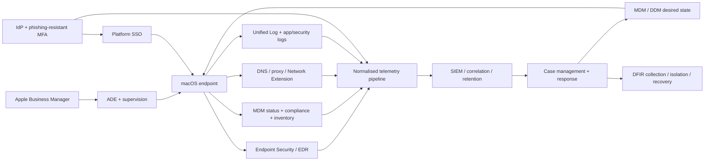

# macOS security and monitoring in 2026

> Practical research for enterprise Macs and SOC/IT teams.
>
> Research snapshot **27 August 2026**, version **1.0**.
> English translation and selected source checks **22 November 2026**.

## 1. Purpose and scope

This document describes a target security and monitoring architecture for **modern macOS releases**, covering Apple's native mechanisms, MDM/EDR/SIEM requirements, hardening recommendations, priority detection scenarios, open-source tools and deployment. Statements about new features, fixes and compatibility apply to the OS versions explicitly named. The dated research snapshot should be rechecked against the linked sources before deployment.

The primary scenario is a managed enterprise fleet of Apple silicon Macs registered through Apple Business Manager or Apple School Manager and Automated Device Enrollment (ADE). Some recommendations also apply to personal devices. Supervision and MDM provide central enforcement of settings, managed approval of eligible system extensions and policy compliance reporting.

Use this architectural and operational guidance alongside the following sources of requirements and evidence.

- The organisation's threat model and risk assessment.
- Applicable regulatory requirements and legal advice.
- Current documentation from the MDM and EDR vendors.
- Tests of each agent and profile on the exact macOS build being deployed.

### Interpreting requirements

- **MUST** identifies a minimum requirement proposed here for a managed production fleet.
- **SHOULD** identifies a strong recommendation. Exceptions need an owner and an expiry date.
- **CONDITIONAL** identifies a measure for a particular scenario or elevated risk.

## 2. Key findings

1. The research snapshot recorded **macOS 26.6.2**, released on 17 August 2026, as the current macOS 26 branch version. Check this dated reference against [Apple Security Releases](https://support.apple.com/en-us/100100) before use. Production policy should compare the installed build with Apple Software Lookup/GDMF and track subsequent security releases.
2. Protecting a Mac requires coordinated controls. A proposed minimum enterprise architecture combines **ADE + supervision + Declarative Device Management + FileVault + Secure Boot/SIP/SSV + Platform SSO/MFA + application control + EDR/Endpoint Security telemetry + network telemetry + SIEM + tested response procedures**.
3. From macOS 26.1, [Background Security Improvements](https://support.apple.com/en-us/102657) provide small security patches for WebKit and other system components between full updates. Manage their automatic installation and permitted removal through the applicable declarative controls.
4. In macOS 26, Apple deprecated software update management through legacy MDM commands, restrictions, payloads and queries. Apple directs administrators towards **declarative software update management**. See [What's new for enterprise in macOS 26](https://support.apple.com/en-us/124963).
5. **Infostealers and user-driven execution** are major widespread threats in 2026. Campaigns use fake applications, malvertising, ClickFix, commands pasted into Terminal and AppleScript to obtain Keychain material, browser cookies, SSH keys and cryptocurrency wallet data. Relevant research includes [Microsoft Threat Intelligence](https://www.microsoft.com/en-us/security/blog/2026/04/16/dissecting-sapphire-sleets-macos-intrusion-from-lure-to-compromise/), [Objective-See](https://objective-see.org/blog.html) and [Jamf Security 360 for Mac 2026](https://media.jamf.com/documents/white-papers/security-360-mac-2026.pdf).
6. Enable Gatekeeper, notarisation checks and XProtect alongside behavioural EDR. Users can authorise dangerous actions, signed software can be compromised and new samples may precede available signatures.
7. The **Apple Endpoint Security API** is a principal source of modern process, file, TCC, Gatekeeper/XProtect and selected system events. Build new monitoring around supported event sources. OpenBSM is a legacy interface, and auditing is disabled by default from macOS 14.
8. `google/santa` was archived in February 2025. For a new deployment, assess the maintained [northpolesec/santa](https://github.com/northpolesec/santa) project and its documented validation on the macOS releases in use.
9. A general claim of macOS support needs release-specific validation. Examples include osquery issues affecting `certificates` and `package_receipts` on macOS 26, and content-filter extension compatibility issues in 26.4–26.5. Use canary deployment rings and a local acceptance test suite.
10. Collect the minimum telemetry needed for the security purpose. Full command lines, environment variables, URLs, file names and log content can contain secrets and personal data. Define the purpose, access controls and retention for each field.

## 3. Significant changes in macOS 26

### 3.1. Updates and Background Security Improvements

[Background Security Improvements (BSI)](https://support.apple.com/guide/deployment/background-security-improvements-dep93ff7ea78/web) apply small patches through cryptographically sealed cryptex images. On a Mac, a Safari fix may take effect after Safari restarts, while system-wide application requires an OS restart. The research snapshot records the following BSI properties.

- Available from macOS 26.1.
- Managed independently of ordinary software update deferrals and available for the latest eligible minor release.
- Removable by the user unless management prevents rollback.
- Reported to MDM through declarative status items.
- Enforced using `TargetOSVersion` and `TargetBuildVersion` when the relevant declaration specifies an installation.

The first published BSI release in 2026 addressed WebKit on macOS 26.3.1/26.3.2. Apple maintains the release list under [Background Security Improvements by date](https://support.apple.com/en-us/111333).

Track minor releases and BSI as **two linked update controls**. Keeping a device months behind on minor releases can make it ineligible for the BSI associated with the latest minor branch.

### 3.2. Declarative Device Management as the management foundation

macOS 26 extends declarative management in several areas.

- `.pkg` installation through [`com.apple.configuration.package`](https://github.com/apple/device-management/blob/release/declarative/declarations/configurations/package.yaml).
- Management of App Store, Custom Apps and already installed applications through [`AppManaged`](https://github.com/apple/device-management/blob/release/declarative/declarations/configurations/app.managed.yaml).
- Safari, extensions and automatic application updates.
- Enforcement of a specific OS version/build and deadline.
- MDM migration through Apple Business Manager or Apple School Manager.
- Status reports that reduce the need for repeated device queries.

The official machine-readable schema is published in [apple/device-management](https://github.com/apple/device-management). Use it to check supported keys, OS availability and enrolment scopes before constructing a management payload.

### 3.3. Platform SSO and identity

[Platform SSO](https://support.apple.com/guide/deployment/platform-sso-for-macos-dep7bbb05313/web) in macOS 26 supports the following capabilities, subject to the identity provider's extension and deployment requirements.

- Activation and enforced registration during ADE/Setup Assistant.
- Creation of the first local user from identity provider information.
- Authenticated Guest Mode.
- Tap to Login with compatible NFC credentials.
- Shared device keys and device attestation.
- Password synchronisation or authentication using a Secure Enclave-backed key.

The identity architecture must also account for FileVault, Secure Token, Bootstrap Token and a local emergency access procedure. Test offline login, recovery from identity provider lockout, local administrator password rotation and removal of departed employees' accounts.

### 3.4. FileVault and remote access

On Apple silicon, macOS 26 supports unlocking [FileVault](https://support.apple.com/guide/security/sec8447f5049/web) over SSH after a restart when Remote Login and a network connection are available. This assists remote and headless operations while extending the remote access surface into the pre-login workflow.

Under this proposed baseline, **Remote Login MUST be disabled by default**. Enable it through a specific policy with network segmentation, key-based authentication, disabled password authentication, a restricted user allow-list, monitoring and an accountable owner. Record the operational need for remote support before enabling it.

Apple recommends a **Personal Recovery Key (PRK)** for recovery. Escrow the PRK in MDM, audit access and regularly confirm escrow status. In macOS 26, MDM can automatically rotate an existing PRK before escrow when a Bootstrap Token is present. Assess existing Institutional Recovery Key (IRK) workflows against current Apple guidance.

### 3.5. Networking, USB and legacy compatibility

- macOS 26 adds a privacy-preserving [Network Extension URL Filter](https://developer.apple.com/documentation/networkextension/url-filters), using a local Bloom filter and Private Information Retrieval for large URL sets.
- Accessory security settings also apply in macOS Recovery. The enterprise baseline should block new accessories or request approval while a Mac is locked, subject to the hardware and management capabilities in use.
- macOS 26 removes support for DES, 3DES, SHA1-96/SHA1-160 and Diffie-Hellman groups below 14 for IKEv2. Update VPN concentrators that require these algorithms.
- macOS 26.4 introduced notifications about future incompatibility for applications using Rosetta. Apple stated that Rosetta application support would remain available through macOS 27. Maintain an inventory of x86-only software and a migration plan.
- macOS 26 supports a limited set of late Intel models. Prefer Apple silicon for new procurement. Check the official [Mac models compatible with macOS 26](https://support.apple.com/en-us/122867).

## 4. Threat model for 2026

### 4.1. Priority adversaries and scenarios

| Scenario | Typical sequence | What to protect and observe |
|---|---|---|
| ClickFix / fake utility | Browser → instruction to open Terminal → paste/run shell → `curl`/`osascript` → payload | Parent-child process tree, clipboard/Terminal boundary, shell command, download, quarantine, code signature, egress |
| Infostealer | Fake DMG/PKG/application → password prompt → Keychain/browser/Telegram/cryptocurrency/SSH collection → archive → HTTPS exfiltration | Launch source, authentication prompt, access to sensitive directories, `security`, `sqlite3`, `ditto`/`zip`, bulk reads, unusual destination domain |
| Supply chain | Compromised npm/pip/Homebrew/package/update → post-install script → C2 | Package manager, package scripts, integrity/signature, build runner identity, outbound traffic |
| Persistence | LaunchAgent/LaunchDaemon, login item/BTM, shell profile, cron, configuration profile | Creation or modification of plist files, `launchctl`, BTM events, executable target and signature |
| TCC/Gatekeeper abuse | `tccutil`, direct database or MDM override abuse, `xattr -d`, `spctl`, trusted parent | Endpoint Security TCC/Gatekeeper events, SIP state, TCC database writes, quarantine removal |
| Credential/session theft | Keychain, browser cookies/tokens, SSH keys, cloud CLI credentials | Process-to-object access relationships, unusual reader, archive/exfiltration correlation, identity-side impossible travel or token use |
| Remote access | SSH, Screen Sharing, Remote Management, commercial RMM | Service state, new listener, login events, unexpected tool or Team ID, network source |
| Physical/evil-maid attack | Lost Mac, boot/recovery/accessory attack | FileVault, Secure Boot, SSV/SIP, Activation Lock, USB restrictions, supported loss response and MDM erase procedures |
| Targeted spyware | Zero-click/zero-day attack against a high-value person | Current patches, Lockdown Mode, minimal attack surface, dedicated device, enhanced SOC handling |

### 4.2. Observations from reported campaigns

- [Microsoft's Sapphire Sleet macOS intrusion analysis](https://www.microsoft.com/en-us/security/blog/2026/04/16/dissecting-sapphire-sleets-macos-intrusion-from-lure-to-compromise/) describes user-driven execution, `.scpt` files, staged downloads, fake system dialogues, attempts involving TCC, LaunchDaemons and theft of browser/Keychain/SSH/Telegram/cryptocurrency data.
- The [Microsoft macOS security research feed](https://www.microsoft.com/en-us/security/blog/tag/macos/) covered fake utilities, ClickFix and compromised Axios npm packages as supply-chain concerns in 2026.
- [Objective-See research](https://objective-see.org/blog.html) in 2026 examined stealers, ClickFix protections in macOS 26.4 and detection of dylib abuse.
- [Jamf Security 360 for Mac 2026](https://media.jamf.com/documents/white-papers/security-360-mac-2026.pdf) reports a large infostealer share within its observed macOS malware data. Interpret the figures within the report's sample and methodology.
- [MITRE ATT&CK Gatekeeper Bypass T1553.001](https://attack.mitre.org/techniques/T1553/001/), [TCC Manipulation T1548.006](https://attack.mitre.org/techniques/T1548/006/) and [Launch Agent T1543.001](https://attack.mitre.org/techniques/T1543/001/) provide a taxonomy for mapping detections and tests.

## 5. Target security and monitoring architecture

### Principles

1. Manage **desired state through MDM/DDM** and verify the resulting device status.
2. **Keep Apple's security controls enabled when deploying agents.** A product that requires permanently disabling SIP, SSV, Secure Boot or Gatekeeper is unsuitable for this production baseline.
3. Use **Endpoint Security for behaviour and osquery/MDM for state**. Periodic inventory leaves gaps between observations of process, file and TCC activity.
4. Maintain **dedicated prevention and detection layers**. Santa/EDR can block, SIEM can correlate and MDM can restore the desired configuration.
5. **Plan failure handling to preserve fleet availability.** Before enforcing application control, deploy monitor mode, canary rings, local caches and emergency access procedures.
6. **Collect each field for a defined detection purpose.** Assign an owner, purpose and retention period to each dataset.

## 6. Required baseline

### 6.1. MUST requirements

| Area | Requirement | Verification/evidence |
|---|---|---|
| Ownership | Corporate Macs are registered in ABM/ASM and use ADE with supervised enrolment | MDM inventory showing enrolment method, supervision and server assignment |
| MDM trust | Prevent user removal of MDM and monitor APNs/identity certificate expiry and MDM migration | Daily status and alerts for unenrolment or certificate expiry |
| Updates | DDM sets a minimum version, enforcement deadline and status reporting | Installed OS version/build against Apple GDMF, download/prepare/install status |
| BSI | Set `InstallSecurityUpdate=AlwaysOn` where supported and prevent users from disabling automatic installation or removing improvements outside policy | Supplemental extra version/build in declarative status |
| Boot integrity | Enable Full Security, SIP and SSV. Reduced Security requires an exception | `csrutil status`, MDM/EDR posture, recovery policy inventory |
| Encryption | Enable FileVault, confirm PRK escrow and escrow the Bootstrap Token | MDM escrow status, `fdesetup status`, `profiles status -type bootstraptoken` |
| Identity | Everyday users have standard accounts, identity provider MFA resists phishing and Platform SSO is enabled where supported | Local groups, Platform SSO registration, identity provider policy and sign-in logs |
| Accounts | Manage a unique emergency administrator account with a rotating secret. Shared passwords are prohibited | LAPS-style escrow/audit, account inventory, last rotation |
| Apps | Enable Gatekeeper, notarisation checks and XProtect. Obtain software from approved sources | `spctl` state, signature/Team ID inventory, XProtect version/events |
| Application control | Observe unknown executables before restricting them through a risk-based policy | Santa/EDR policy, block/allow decisions, time-limited exceptions |
| Firewall | Enable Application Firewall, minimise inbound permissions and enable stealth mode for laptops | MDM payload `com.apple.security.firewall`, socket/listener inventory |
| Remote services | Disable Remote Login, Screen Sharing, Remote Management, AirPlay Receiver and content caching unless required | Periodic service state checks and change alerts |
| Extensions | Approve System/Network/Endpoint Security extensions by Team ID and bundle ID. Minimise legacy kext use | MDM profile, `systemextensionsctl list`, kext inventory |
| Privacy | PPPC/TCC grants only necessary access. Limit Full Disk Access by a specific designated requirement | PPPC profile, TCC change events, weekly review of permission recipients |
| EDR | The vendor supports the deployed macOS build and Apple silicon. Enable tamper protection | Health heartbeat, extension state, version policy, synthetic tests |
| Telemetry | Correlate process, persistence, TCC/Gatekeeper/XProtect, network and identity events by host/user/process | Schema validation and test events in the SIEM |
| Time | Synchronise clocks automatically and record timezone context with events | Clock drift alert and UTC normalisation in the pipeline |
| Backup | Maintain tested backups and restores of corporate data. Encrypt backups and protect recovery keys separately | Successful restore test, backup age and encryption status |
| Response | Provide remote isolation, triage collection and controlled erase/redeployment with audited actions | Quarterly tabletop and technical exercises |

### 6.2. SHOULD requirements

- Use Apple silicon as the procurement baseline. Place Intel Macs in a separate lifecycle risk group and retire them before their supported lifecycle ends.
- Apply the appropriate [CIS Benchmark for macOS 26 v1.1.0](https://www.cisecurity.org/benchmark/apple_os) or [mSCP](https://pages.nist.gov/macos_security/) profile, adapted to business functions and the deployed OS release.
- Require a password immediately after sleep or screen saver activation and set a reasonable idle timeout.
- Block new accessories while the device is locked. For elevated risk, consider “Ask Every Time”.
- Restrict AirDrop, iCloud Drive, external media, consumer Apple Accounts, Universal Control and Continuity functions according to data classification and the threat model.
- Manage Safari settings and extensions, blocking unapproved extensions and unsafe policy changes.
- Manage Apple Intelligence and External Intelligence declarations from macOS 26.4 when corporate data must be kept within approved models and integrations.
- Use encrypted DNS, a secure web gateway or privacy-preserving URL filtering where justified by the threat model.
- Inventory Homebrew, npm, pip, VS Code/Xcode extensions and other developer supply chains.
- Sign in-house packages with Developer ID Installer, notarise applications and verify the designated requirement before installation.
- Build allow-lists using Team ID, signing certificate, bundle ID, notarisation, path and provenance as appropriate. Rules based solely on a hash need revision whenever the file changes.

### 6.3. Conditions for Lockdown Mode

[Lockdown Mode](https://support.apple.com/en-us/105120) is intended for the small number of people at risk from sophisticated targeted spyware and substantially restricts functionality. Apply it as a **CONDITIONAL** measure for the following cases.

- Journalists, human rights defenders, diplomats and political or military leaders.
- Staff with access to particularly sensitive data.
- An active mercenary spyware campaign targeting the organisation or person.

A general fleet still needs MDM, patching, EDR and least privilege alongside any Lockdown Mode deployment.

## 7. Update and vulnerability policy

### 7.1. Proposed organisational SLA

The following deployment targets are proposed for the organisation. They are independent of Apple's published commitments.

| Class | Example | Maximum production deployment time |
|---|---|---:|
| Emergency | Active exploitation, zero-day, widespread critical attack, urgent BSI | 24–72 hours |
| Critical/High | Kernel/RCE/sandbox escape/root/credential exposure | 7 days |
| Standard security update | Ordinary update within a macOS major release | 14 days |
| Major upgrade | New macOS major version after compatibility validation | 30–60 days, before the current branch reaches end of support |
| Critical third-party app update | Browser, VPN, EDR, developer tooling | 72 hours–7 days according to risk |

### 7.2. Deployment rings

1. **Lab** covers virtual and physical test Macs, smoke tests, upgrades and rollback tests.
2. **Canary** covers 1–3% of volunteers and IT/security staff, representing hardware models and critical applications.
3. **Early production** covers 10–20% of devices without critical workflows.
4. **Broad production** covers the rest of the fleet.
5. **Critical devices** use a dedicated deployment window with a defined deadline.

For an actively exploited vulnerability, shorten each ring's observation period while retaining a minimum automated smoke test of boot/login, FileVault, Platform SSO, VPN/content filters, EDR heartbeat, developer tools and business-critical applications.

### 7.3. Monitoring update currency

- Use Apple GDMF (`https://gdmf.apple.com/v2/pmv`) and [Apple Security Releases](https://support.apple.com/en-us/100100) as sources of available versions.
- Compare **version + build + supplemental build**.
- Alert on missed enforcement deadlines, insufficient storage/power, a missing Bootstrap Token or a device remaining offline beyond the SLA.
- Track XProtect, Gatekeeper configuration data and other system data files separately because they can update independently of a full OS update.
- Account for the limits of CVE matching on macOS. Apple often delivers a fix in a particular OS build, and matching a bundled library to its upstream version can be ambiguous.

## 8. Telemetry sources

| Source | Purpose | Strengths | Limitations |
|---|---|---|---|
| [Endpoint Security API](https://developer.apple.com/documentation/endpointsecurity) | Exec/fork/exit, files, mounts, TCC, XPC, Gatekeeper/XProtect and other security events | Detailed process context, notification events and authorisation decisions | Entitlement and FDA/MDM requirements, deployment-specific system extension approval, event drop/timeout risks, SDK/OS compatibility |
| MDM/DDM status | Desired state, FileVault escrow, OS/update status, profiles, apps, hardware | Authoritative management and posture reporting | Check-in and status reporting intervals limit timeliness |
| [Unified Logging / OSLog](https://developer.apple.com/documentation/os/logging/) | System and application events, authentication/service diagnostics | Rich context and subsystem/category filtering | Binary storage, dynamic retention, private field redaction, text changes between releases |
| osquery | Snapshot/differential inventory, users, apps, extensions, launch items, processes, ES event tables | Unified SQL and the Fleet ecosystem | CI coverage varies by table and OS, event tables require appropriate signatures/FDA, polling leaves observation gaps |
| Network Extension / DNS / SWG | Flows, DNS, URL verdicts, egress | Visibility into C2 and exfiltration beyond process events | TLS content is usually encrypted, privacy/legal constraints, extension conflicts require testing |
| Identity provider | Platform SSO registration, sign-in, MFA, token/session risk | Visibility into compromise beyond the Mac | Device/user/session correlation and time normalisation required |
| App/package manager | Installer, npm/pip/brew/Xcode, CI/build events | Supply-chain context | Varying formats and potential loss of post-install/process lineage |
| EDR proprietary telemetry | Behaviour, reputation, response/isolation | Packaged analytics and response capabilities | Vendor lock-in, cost and opaque coverage gaps. Verify the exact macOS build |

### 8.1. Limits of Unified Log

Unified Log supports diagnosis and operational logging. Retention can rotate events out, privacy mechanisms hide some values and message text changes between releases. Use it as a supplementary source with predicates on stable `subsystem`, `category` and process fields, tested on each release.

### 8.2. OpenBSM in a new architecture

OpenBSM previously supplied process auditing. Endpoint Security is the modern event interface, and auditing is disabled by default from macOS 14. This is also documented in [osquery process auditing](https://github.com/osquery/osquery/blob/master/docs/wiki/deployment/process-auditing.md). Retain legacy auditing where a defined compatibility requirement calls for it, alongside supported real-time telemetry.

### 8.3. Minimum normalised event schema

Where available and justified, each security event should carry the following fields.

- `event.timestamp_utc`, `event.ingested_at`, `event.kind`, `event.outcome`, `event.sequence`.
- `host.id` as a stable MDM identifier, serial/UDID in a protected inventory index, hostname, OS version/build and architecture.
- `user.id`, local UID, identity provider identity and session/login context.
- Process PID and audit token, parent/ancestor chain, executable path, filtered arguments and responsible process.
- SHA-256, Mach-O architecture, bundle ID, Team ID, signing identifier, certificate chain/status and notarisation/platform-binary status.
- Source/destination file path, quarantine/provenance and volume/removable status.
- Remote IP/domain/port/protocol, network interface and VPN context.
- Policy decision, rule ID/version, sensor version and dropped-event counters.
- Correlation/case ID and MITRE ATT&CK mapping.

Filter secrets before transmitting command lines or URLs. Exclude environment variables, full file contents and browser query strings unless a specifically approved forensic purpose requires them. Redact or hash tokens, passwords and personal data at the endpoint or pipeline where possible. The scripts in this repository provide a bounded subset of this target enterprise schema. Consult the repository's current data contract for the fields they actually emit.

## 9. Priority detection rules

### 9.1. P0 — immediate investigation

| Detection | Signal and correlation | MITRE |
|---|---|---|
| Baseline protection disabled | SIP/SSV/Gatekeeper/FileVault/EDR tampering or a missing system extension, with a change outside approved maintenance | T1562, T1553 |
| XProtect malware event | Endpoint Security reports XProtect detection/remediation. Record the signature, file, responsible process and available source URL | Malware defence |
| TCC database tampering | Unauthorised write to system/user `TCC.db`, `launchctl` environment override or unexpected `tccutil`, especially with SIP disabled | [T1548.006](https://attack.mitre.org/techniques/T1548/006/) |
| Credential-stealer sequence | Browser/Terminal → shell/AppleScript → download → password prompt/helper → bulk Keychain/browser/SSH/wallet access → archive/egress | T1059.002, T1555, T1005, T1041 |
| Unknown root persistence | New LaunchDaemon/privileged helper/system extension with absent or unusual signing identity and a target in a user-writable or temporary path | T1543.004 |
| Security agent removed | Uninstallation, stop/service disable, extension deactivation or heartbeat loss correlated with a local tamper event | T1562.001 |

### 9.2. P1 — high priority

1. `osascript`/`osascript -e` starts a shell, `curl`, `wget`, Python or Base64 decoding.
2. Terminal/iTerm/an unknown application starts a long obfuscated command line immediately after browser activity or a clipboard-driven workflow.
3. `curl`/`python`/`bash` starts from an installation script (`installer`, `package_script_service`) and connects to a new domain. A reference idea is [Elastic's installer package spawned network event](https://github.com/elastic/detection-rules/blob/main/rules/macos/execution_installer_package_spawned_network_event.toml).
4. Removal of `com.apple.quarantine` through `xattr`, changes to `spctl` or a Gatekeeper user override event.
5. Creation/modification of `~/Library/LaunchAgents`, `/Library/LaunchAgents` or `/Library/LaunchDaemons`, especially when `ProgramArguments` refers to `/tmp`, `/private/tmp`, `/var/tmp`, Downloads, a hidden directory or an unsigned binary.
6. New login/background items (BTM), cron/at jobs, shell profile persistence or unusual `launchctl bootstrap/load` activity.
7. An unexpected process reads `~/Library/Keychains`, browser `Cookies`/`Login Data`, `~/.ssh`, cloud CLI credentials, a Telegram session or cryptocurrency wallet data.
8. `security find-generic-password`, `security dump-keychain` or `sqlite3`/`cp`/`ditto`/`zip` accesses credential stores from an unfamiliar process lineage.
9. Enabling Remote Login, Screen Sharing, Remote Management, a new RMM/remote-control tool or a listener.
10. Installing a root CA, VPN/content filter/DNS proxy/system extension outside an approved change.
11. A trusted process loads an unsigned/ad hoc-signed executable or dylib from a user-writable path.
12. A new local administrator, changes to `sudoers`, Secure Token/volume ownership changes or unusual authorisation attempts.

### 9.3. P2 — hunting and posture drift

- A macOS build below the minimum, a missing BSI or an overdue update deadline.
- PRK/Bootstrap Token escrow missing or FileVault deferred for too long.
- Unapproved Safari/browser/Xcode/VS Code extensions.
- x86-only/Rosetta applications without an owner and migration plan.
- Homebrew/npm/pip packages appearing outside the approved developer group.
- Unusual `DYLD_*` variables, dylib search paths or unsigned plugins/bundles.
- Unexpected removable media mounts, especially with bulk copying.
- Sensor event drops, missed deadlines, queue backlog or a sharp fall in events per host.
- Changes to PPPC/FDA recipients or the system extension allow-list.

### 9.4. Requirements for each production detection

- A unique rule ID, owner, severity and version.
- A specific threat hypothesis and the required telemetry fields.
- An ATT&CK mapping and a clear description of the behaviour.
- Known false positives and scoped allow-list entries with expiry dates.
- A triage runbook identifying the process, signatures, files and network evidence to inspect.
- An automated unit/fixture test and a controlled execution test.
- Metrics for event coverage, alert volume, precision, mean time to triage and sensor drop rate.
- Human approval and a verified rollback plan for destructive response actions, supported by sufficient evidence.

## 10. Tools and GitHub projects

Assess each project's release cadence, artefact signatures/notarisation, security policy, dependencies, licence, Apple silicon support and canary test results. Open-source availability alone provides limited assurance about deployment compatibility.

### 10.1. Management and compliance

| Project | Role | Recommendation/qualification |
|---|---|---|
| [apple/device-management](https://github.com/apple/device-management) | Apple's official MDM/DDM schemas | Authoritative source for payload/declaration keys and OS availability |
| [usnistgov/macos_security](https://github.com/usnistgov/macos_security) | macOS Security Compliance Project (mSCP) | Main open-source generator of baselines, profiles, DDM assets and compliance scripts. The snapshot records revision 3 guidance for macOS 26 in 2026 |
| [Fleet](https://github.com/fleetdm/fleet) | osquery fleet management, inventory, policy and MDM capabilities | Suitable for state/compliance. Evaluate event/EDR coverage separately |
| [Munki](https://github.com/munki/munki) | Managed macOS software distribution | Useful for third-party patching alongside MDM/DDM and EDR |
| [CIS macOS 26](https://www.cisecurity.org/benchmark/apple_os) | Consensus baseline | The snapshot records v1.1.0. Choose Level 1/2 according to the use case and supported OS |

`mSCP` implements the approach in the final [NIST SP 800-219 Rev. 1](https://csrc.nist.gov/pubs/sp/800/219/r1/final) and maps controls to NIST 800-53, CIS, DISA STIG, CNSSI and other frameworks. In June 2026, NIST published [SP 800-219 Rev. 2 as an Initial Public Draft](https://csrc.nist.gov/pubs/sp/800/219/r2/ipd). Treat that edition according to its draft status. Before running generated remediation scripts, define the organisation's overlay and validate it on a canary group.

### 10.2. Endpoint visibility and application control

| Project | Role | Recommendation/qualification |
|---|---|---|
| [North Pole Security Santa](https://github.com/northpolesec/santa) | Binary/file access authorisation and execution telemetry | Maintained fork, with macOS 26 validation recorded in releases. Introduce Monitor → Lockdown through deployment rings |
| [google/santa](https://github.com/google/santa) | Historical Santa upstream | **Archived 5 February 2025**. Use an actively maintained fork for a new production deployment |
| [osquery](https://github.com/osquery/osquery) | SQL inventory and Endpoint Security event tables | Official builds have an ES entitlement. Required privileges and FDA depend on the table and deployment. Validate each table on the selected OS |
| [Mac Monitor](https://github.com/redcanaryco/mac-monitor) | Interactive Endpoint Security tracing/analysis | Useful for a lab, malware triage and detection development. Evaluate fleet management requirements separately |
| [Objective-See tools](https://github.com/objective-see) | BlockBlock, KnockKnock, LuLu, TaskExplorer and research tools | Useful for workstations, labs and incident response. Evaluate central management and enterprise support separately |
| [Velociraptor](https://github.com/Velocidex/velociraptor) | Targeted DFIR collection and hunting | Useful for remote triage/forensics. Prepare a signed client, artefacts and access control in advance |
| [Wazuh](https://github.com/wazuh/wazuh) | Open-source XDR/SIEM, logs/FIM/compliance | Provides a macOS agent. Test real-time/FIM use cases and the required telemetry on macOS |
| [xnumon](https://github.com/droe/xnumon) | Legacy macOS malicious activity monitor | Uses audit/OpenBSM and can support research on older systems. Modern macOS monitoring coverage is limited |

### 10.3. Detection content and control validation

| Project | Purpose |
|---|---|
| [Elastic detection-rules](https://github.com/elastic/detection-rules/tree/main/rules/macos) | Production and reference macOS rules for Elastic Defend |
| [Splunk Security Content](https://github.com/splunk/security_content) | macOS analytic stories and detections, including AMOS/PlistBuddy patterns |
| [SigmaHQ/sigma](https://github.com/SigmaHQ/sigma) | Vendor-neutral rule format. Inventory macOS coverage and adapt rules to the deployed event schema |
| [Atomic Red Team](https://github.com/redcanaryco/atomic-red-team) | Controlled ATT&CK tests of prevention/detection, including macOS |
| [MITRE ATT&CK](https://attack.mitre.org/) | TTP taxonomy, detection strategies and mappings |
| [mac_apt](https://github.com/ydkhatri/mac_apt) | Offline parsing of macOS forensic artefacts. Check support for the required OS version on a test image |

### 10.4. Community macOS hardening projects

- [ERNW Hardening Guide for macOS 26](https://github.com/ernw/hardening/blob/master/operating_system/osx/26/Hardening_Guide-macOS_26_Tahoe_1.0.md) provides a detailed baseline with verification commands as an additional reference alongside Apple/NIST/CIS.
- [ALBATOR](https://github.com/cluster2600/ALBATOR) provides macOS 26 audit and hardening tools with YAML rules and a Swift CLI.
- [Mergen](https://github.com/sametsazak/mergen) provides a GUI/CLI CIS audit for macOS 26 with remediation capabilities.

Review the code and remediation actions of the latter two community projects before executing them with administrator privileges.

## 11. Examples of compatibility risks on macOS 26

### 11.1. osquery

- [Issue #8830](https://github.com/osquery/osquery/issues/8830) describes a macOS 26 `certificates` table issue associated with login keychain corruption/renaming after an unclean shutdown. The issue was closed after a fix. Require a version containing the fix and a regression test for production use.
- [Issue #8969](https://github.com/osquery/osquery/issues/8969) describes stale/incomplete `package_receipts` data in a long-lived process on macOS 26.4.1/26.5.1. It was open at the research snapshot and was closed as completed on 30 October 2026. Confirm that the deployed osquery release includes the fix.
- The installation documentation in the snapshot listed CI testing on macOS 14/15. Include each table used in the local acceptance suite and check current upstream CI coverage.

### 11.2. Network/content filter extensions

In macOS 26.4.1–26.5.1, Apple addressed cases in which content-filter extensions interfered with 802.1X connectivity or caused unexpected restarts/shutdowns on selected M5 Macs. See the [enterprise release notes](https://support.apple.com/en-us/124963). Update network security agents through the same deployment rings as the OS, including tests of Wi-Fi 802.1X, VPN, sleep/wake and network transitions.

### 11.3. Compliance false positives

Changes in APIs or preferences can produce a false non-compliance result even when an MDM profile is correctly applied. One example is the resolved [mSCP issue #635](https://github.com/usnistgov/macos_security/issues/635), concerning screen saver password verification on macOS 26. A compliance engine should retain the supporting evidence and explicitly report an indeterminate check when it cannot establish the state.

## 12. Privacy, monitoring system security and retention

### 12.1. Privacy by design

- Define the purpose and legal basis of each field before collection.
- Exclude file contents, clipboard contents, complete browser history, private messages and keystrokes from default collection.
- Redact secrets in command lines and environment variables at the endpoint or pipeline.
- Separate inventory, high-volume telemetry and forensic evidence into datasets with appropriate access permissions.
- Protect SOC access to personal data using RBAC, MFA, bulk export approval and an immutable audit log.
- Inform staff about monitoring in accordance with applicable law.

### 12.2. Proposed retention

The organisation and applicable law determine the actual periods. An initial operating model can use the following targets.

- Raw high-volume endpoint/network events retained in hot storage for 14–30 days.
- Normalised security events searchable for 90 days.
- Alerts/cases and necessary evidence retained for 1 year or the policy/regulatory period.
- Compliance posture history retained for 1 year for trends and audit.
- Malware samples and sensitive forensic images held in separate encrypted storage with minimal retention and strict access.

### 12.3. Protecting the pipeline

- Use mTLS and device identity between sensors and collectors.
- Sign configurations and rules, and control deployment.
- Validate schemas and implement backpressure with bounded local spooling.
- Monitor event loss, sequence gaps, clock drift and agent health.
- Encrypt data at rest, rotate keys and separate tenants.
- Maintain immutable audit records for administrator and responder actions.
- Keep secrets/API keys out of agent configuration files and logs.

## 13. Incident response

### 13.1. Initial actions for a suspected infostealer

1. Open a case and preserve the timeline/telemetry before changing the system.
2. Isolate the network through EDR or a controlled MDM/network policy while retaining the management channel where appropriate.
3. Collect the process tree, open connections, persistence, code-signing metadata, quarantine provenance, relevant Unified Log records and targeted files/hashes.
4. Assess exposure of browser sessions/cookies, Keychain secrets, SSH/cloud/API keys, Telegram sessions and cryptocurrency wallet material accessible to the process, alongside the Mac password.
5. Revoke sessions and tokens at the identity provider/SaaS service and rotate secrets from a **trusted, clean** device. Cover every credential and session implicated by the access evidence.
6. Hunt on other devices using behaviour, signing identity, domains, hashes and persistence indicators.
7. For a confirmed credential stealer, prefer erase/redeployment through ADE after preserving necessary evidence. Validate recovery against the full compromise scope.
8. Restore verified data, re-enrol, confirm FileVault/PRK/EDR/Platform SSO and close the case after post-incident hunting.

### 13.2. Emergency access and destructive actions

- Remote wipe/Erase All Content and Settings requires two independent operational confirmations and exact identification of the asset and owner under the organisation's procedure.
- Keep isolation reversible and preserve the MDM/EDR control plane where the incident allows it.
- Audit recovery key access and require an incident/change ticket.
- Assess the impact and rollback plan before a fleet-wide hash or Team ID block.

## 14. A 90-day deployment plan

### Days 0–15 — inventory and minimum controls

- Inventory hardware, OS/build, Intel/Apple silicon, FileVault/PRK/Bootstrap Token, administrator accounts, applications, extensions and remote services.
- Configure ABM/ADE, prevent user removal of MDM and establish ownership.
- Define the minimum OS and emergency patch SLA, and enable BSI automatic installation where supported.
- Select an mSCP/CIS Level 1 baseline and record exceptions.
- Define the privacy notice, telemetry fields and retention.

### Days 16–30 — hardening and identity

- Deploy FileVault PRK escrow/rotation, firewall, screen lock, USB/accessory and sharing restrictions.
- Move everyday work to standard accounts and introduce a managed emergency administrator account with a rotating secret.
- Pilot Platform SSO, phishing-resistant MFA, attestation and shared device keys.
- Inventory Rosetta/x86-only software and kernel/system/network extensions.

### Days 31–60 — telemetry and detections

- Validate the EDR/Endpoint Security sensor on the deployed macOS release, then deploy it through rings.
- Connect MDM/DDM, identity, DNS/proxy/network and application/package data to the SIEM.
- Normalise process, signing and provenance fields.
- Implement P0/P1 detections for ClickFix, infostealers, persistence, TCC/Gatekeeper, remote access and EDR tampering.
- Deploy Santa in Monitor mode first if application control is part of the target architecture.

### Days 61–90 — validation and response

- Run reviewed macOS Atomic Red Team tests in an isolated lab.
- Test the full sequence of event → alert → case → isolation → evidence → recovery.
- Measure coverage, alert latency, dropped events, false positives and performance/battery impact.
- Move validated Santa rules to an enforcing mode through deployment rings.
- Run an infostealer/supply-chain tabletop exercise and update the runbooks.

## 15. Acceptance checks for each new macOS build

- [ ] Boot, login, logout, sleep/wake and FileVault unlock work.
- [ ] Bootstrap Token and PRK escrow status remain valid.
- [ ] ADE/DDM status reporting and software update declarations apply.
- [ ] Platform SSO online/offline login, password change, token refresh and emergency access are tested.
- [ ] The EDR/ES system extension is loaded, FDA is valid and heartbeats arrive.
- [ ] Synthetic exec/file/TCC/Gatekeeper/XProtect-like test events reach the SIEM.
- [ ] Event drops, missed deadlines and CPU/memory/battery impact are within accepted limits.
- [ ] VPN, 802.1X Wi-Fi, Network/content filters, DNS and proxy work after sleep and network changes.
- [ ] Santa/allow-listing permits platform and business applications and continues to receive policy.
- [ ] osquery/Fleet policies return correct data and critical tables pass regression tests.
- [ ] Backups and a test restore are available.
- [ ] Core business applications, developer tools, accessibility and peripherals are tested.
- [ ] Known Apple/vendor issues have been reviewed and risk acceptance recorded.

## 16. Maturity metrics

| Metric | Target after stabilisation |
|---|---:|
| ADE/supervised coverage | 100% of corporate Macs |
| FileVault + confirmed PRK escrow | ≥ 99%, with active remediation for the remainder |
| Latest approved macOS build within SLA | ≥ 95% before the deadline, 100% after the enforcement grace period |
| BSI automatic installation | 100% of eligible supervised Macs |
| Healthy EDR heartbeat within 24 hours | ≥ 99% of online Macs |
| P0 event-to-alert latency | < 5 minutes |
| P1 event-to-alert latency | < 15 minutes |
| Sensor dropped-event rate | Measured, with an alert for deviation from baseline |
| Unknown local administrators | 0 |
| Security exceptions without owners | 0 |
| Quarterly restore/IR exercise | 100% completed |

## 17. Source hierarchy

When sources conflict, use the following order.

1. Apple Platform Security, Apple Platform Deployment, Apple Developer APIs and the machine-readable `apple/device-management` schema.
2. Apple Security Releases and enterprise release notes for the exact build.
3. NIST mSCP/SP 800-219 and the applicable regulatory baseline.
4. The CIS Benchmark for the deployed macOS release.
5. Documentation and release notes for the specific product/repository.
6. Vendor threat research with reproducible technical details.
7. Community guides/tools after review and testing.

## 18. Reference links

### Apple technical and deployment documentation

- [Apple Platform Security Guide (PDF, 2026)](https://help.apple.com/pdf/security/en_US/apple-platform-security-guide.pdf)
- [Apple Security Releases](https://support.apple.com/en-us/100100)
- [Security content of macOS 26.6](https://support.apple.com/en-us/128067)
- [What's new for enterprise in macOS 26](https://support.apple.com/en-us/124963)
- [macOS release notes](https://developer.apple.com/documentation/macos-release-notes)
- [Background Security Improvements](https://support.apple.com/guide/deployment/background-security-improvements-dep93ff7ea78/web)
- [Install and enforce software updates](https://support.apple.com/guide/deployment/install-and-enforce-software-updates-depd30715cbb/web)
- [Declarative Device Management](https://support.apple.com/guide/deployment/declarative-device-management-manage-apple-depc30268577/web)
- [Platform SSO for macOS](https://support.apple.com/guide/deployment/platform-sso-for-macos-dep7bbb05313/web)
- [Secure Token, Bootstrap Token and volume ownership](https://support.apple.com/guide/deployment/use-secure-and-bootstrap-tokens-dep24dbdcf9e/web)
- [Managing FileVault](https://support.apple.com/guide/security/sec8447f5049/web)
- [Signed System Volume](https://support.apple.com/guide/security/signed-system-volume-security-secd698747c9/web)
- [Gatekeeper and runtime protection](https://support.apple.com/guide/security/gatekeeper-and-runtime-protection-sec5599b66df/web)
- [Protecting against malware / XProtect](https://support.apple.com/guide/security/protecting-against-malware-sec469d47bd8/web)
- [System Integrity Protection](https://support.apple.com/en-us/102149)
- [Endpoint Security API](https://developer.apple.com/documentation/endpointsecurity)
- [Network Extension content filters](https://developer.apple.com/documentation/networkextension/content-filter-providers)
- [Unified Logging](https://developer.apple.com/documentation/os/logging/)
- [Device management restrictions for Mac](https://support.apple.com/guide/deployment/restrictions-for-mac-depba790e53/web)
- [Firewall MDM payload](https://support.apple.com/guide/deployment/firewall-payload-settings-dep8d306275f/web)

### Standards and baselines

- [NIST macOS Security Compliance Project](https://pages.nist.gov/macos_security/)
- [NIST mSCP GitHub](https://github.com/usnistgov/macos_security)
- [NIST SP 800-219 Rev. 1 (Final)](https://csrc.nist.gov/pubs/sp/800/219/r1/final)
- [NIST SP 800-219 Rev. 2 (Initial Public Draft, June 2026)](https://csrc.nist.gov/pubs/sp/800/219/r2/ipd)
- [CIS Apple macOS Benchmarks](https://www.cisecurity.org/benchmark/apple_os)
- [CIS July 2026 update for macOS 26 v1.1.0](https://www.cisecurity.org/insights/blog/cis-benchmarks-july-2026-update)
- [MITRE ATT&CK Enterprise techniques](https://attack.mitre.org/techniques/enterprise/)

### Recent threat research

- [Microsoft's Sapphire Sleet macOS intrusion analysis, 2026](https://www.microsoft.com/en-us/security/blog/2026/04/16/dissecting-sapphire-sleets-macos-intrusion-from-lure-to-compromise/)
- [Microsoft Security Blog for macOS](https://www.microsoft.com/en-us/security/blog/tag/macos/)
- [Objective-See Blog for macOS malware and defences](https://objective-see.org/blog.html)
- [Objective-See, The Mac Malware of 2025, published in 2026](https://objective-see.org/downloads/MacMalware_2025.pdf)
- [Jamf Security 360 for Mac 2026](https://media.jamf.com/documents/white-papers/security-360-mac-2026.pdf)
- [Unit 42 Operation FlutterBridge / FlutterShell, 2026](https://unit42.paloaltonetworks.com/flutterbridge-new-fluttershell-backdoor/)
- [ERNW Hardening Guide for macOS 26](https://github.com/ernw/hardening/blob/master/operating_system/osx/26/Hardening_Guide-macOS_26_Tahoe_1.0.md)

## 19. Review schedule

- **Weekly**, review Apple Security Releases, BSI, exploited vulnerabilities and EDR/MDM advisories.
- **For each build**, review Apple's enterprise/release notes and run the acceptance checklist above.
- **Monthly**, review application/extension inventory, administrator/FDA/PPPC drift, detection health and privacy/retention exceptions.
- **Quarterly**, review mSCP/CIS revisions and the threat model, validate detections with reviewed Atomic Red Team tests, and exercise restore/incident response.
- **Annually**, review hardware lifecycle, Intel/Rosetta retirement, vendor architecture and contractual security requirements.

---

### Operational outcome

A secured Mac fleet requires a continuously verified state. MDM/DDM sets and confirms configuration, Apple's security layers provide a root of trust, Endpoint Security/EDR observes behaviour, network and identity provider events add context, and SIEM correlates the evidence. Tested runbooks connect alerts to controlled recovery. Measure the ability to detect and contain user-driven infostealers, persistence, credential theft and tampering while preserving privacy and device availability.
